# Bifrost Desktop — native CUI workspace

Bifrost now has a separate native desktop executable built with Go and the
CUI Go bindings. CUI renders native GTK controls and its native chat surface on
Linux. There is no browser, JavaScript or Node application runtime.

## Build and launch

Keep the CUI checkout beside Bifrost (`../cui`). A fresh checkout needs the
[pinned revision and compatibility patch](../patches/README.md) included in this
repository. Install Go 1.26+, CMake, a C
compiler, pkg-config, GTK 4.6+ development libraries with X11 support, and Xext
development libraries. On Debian/Ubuntu the native development packages are
`libgtk-4-dev` and `libxext-dev`.

```sh
make desktop
./bin/bifrost-desktop
./bin/bifrost-desktop --root /path/to/repository
./bin/bifrost-desktop --project myapp --repository api --profile work
./bin/bifrost-desktop --root /path/to/repository --state-dir /tmp/bifrost-gui-state
```

Starting without `--root` or `--project` opens the project chooser before acquiring
any workspace. Search saved projects, choose a linked repository, then open it;
Enter in search opens the matching selection. Down moves focus to the project
list. **Open a folder** uses the native folder dialog; **Use current folder** is
an explicit choice. Configured default projects are selected, never opened without
a choice. Repository mappings follow `--environment`. Missing mappings and empty
projects are explained; failed opens leave the chooser available for retry. This
startup behavior is desktop-only; CLI and TUI root selection are unchanged.


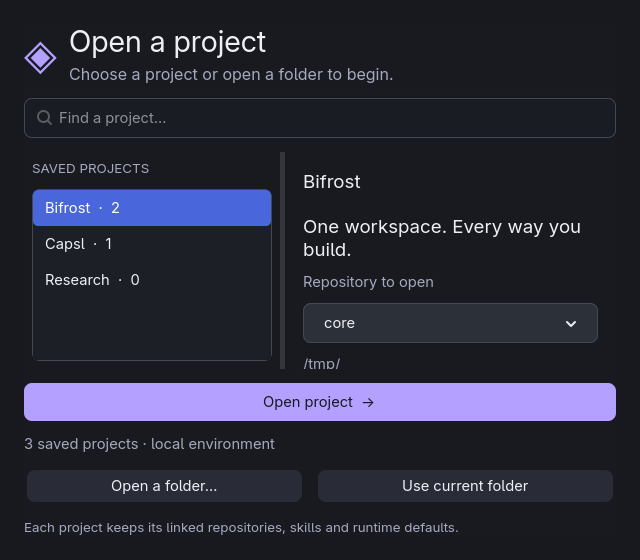

For a different CUI checkout, build its `cui` CMake target, then run
`go mod edit -replace=cui.local/cui=/absolute/path/to/cui/bindings/go` inside
`desktop/`. Build the bindings and C library from the same checkout; an outdated
archive can link against the wrong ABI. The toolkit remains an early prototype.

The GUI uses the same `--config`, `--state-dir`, `--project`, `--repository`,
provider/runtime flags and account settings as the CLI. Agent write and command
permissions retain their configured values. An empty configuration opens an
offline workspace with files, editing, a shell and review. Use **Accounts** in the sidebar to add a provider profile, discover models and connect. Existing
`bifrost setup` and account commands continue to work.

`BIFROST_DESKTOP_SIZE=800x720` chooses the initial logical window size.
`BIFROST_DESKTOP_TEXT_SCALE=1.5` enlarges native text. Sidebar/context panes start
hidden at narrow sizes; their toolbar buttons and keyboard shortcuts reveal them.

## Interaction

- Project, Tasks, Skills, MCP servers, Accounts and Settings have direct navigation.
  Project opens a multi-repository overview with branch/change summaries and
  repository actions. Configuration provides common runtime/tool controls and
  an advanced JSON view; switching views and refreshing retains staged edits.
- Skills and MCP servers have separate catalog destinations with search,
  source previews and project/global installation. The GUI uses the existing
  catalog services: built-in/configured skill catalogs and MCP registry search.
  It does not add new public skill API federation or OAuth flows.
- Tasks can be searched and filtered by state. Results/activity are the default;
  IDs, worktrees and execution budgets remain available under Execution details.
- Charcoal surfaces, violet actions and cyan focus organize Chats/Files on the
  left, the conversation in the center and optional source/terminal context on
  the right. Both dividers are draggable. Compact windows hide optional welcome
  content and panes; toolbar actions keep them accessible.
- Ctrl+K opens searchable commands, saved conversations and files. Enter a colon
  command in the composer or choose one from the palette. The command entry has
  Tab completion, Up/Down history, usage help and retained invalid input.
  `:help` and `:help COMMAND` use the TUI's command registry.
- Enter sends. Shift+Enter, Alt+Enter, Ctrl+Enter and Ctrl+J insert a newline in
  the composer. It grows to the configured row cap. Stop/Escape cancels the turn;
  Ctrl+L focuses the composer. Typing `@` opens file/repository/diff/terminal
  completion; Tab/Enter accepts. Sending attaches the same bounded context as
  the TUI, through the rooted backend.
- User prompts appear in right-aligned violet bubbles labeled “You”; assistant
  replies stay on the left. Consecutive tool, status and reasoning events share
  one collapsed Activity row. Its disclosure reveals the original event text
  and details; Copy/Read full message on that row includes the entire group.
  The Latest activity button jumps to and toggles the latest group. There is no
  second activity log panel competing with the conversation above the composer.
- A visible tab strip runs independent conversations concurrently, with up to
  32 open tabs. Each tab retains its own draft, transcript, activity and reading
  position. **+ / Ctrl+N** opens a tab; **Ctrl+Tab / Ctrl+Shift+Tab** cycles;
  **Ctrl+W** closes the selected idle tab. Arrow buttons handle overflow on narrow
  windows. Running indicators and unread-result dots make background state visible.
  **Stop/Escape cancels only the selected tab**; opening or closing another idle
  tab does not interrupt background turns. Closing a running tab requires stopping
  it first; closing an unsent draft requires an explicit discard action.
- Saved conversations reopen in their existing tab, or a new tab if not already
  open. History stays in the shared session store; the open-tab arrangement and
  unsent composer drafts are not restored after application exit. All tabs share
  the workspace account/model, and switching it waits until every turn finishes.
  Native API and Cursor-native turns use independent session state. External
  Cursor/Claude CLI accounts retain their existing one-turn-per-account lock and
  report a busy-account error if that account is already running.
- Background events cannot replace the active transcript or open the source
  viewer over another conversation. The most recent background viewer request
  opens when its tab is selected. Command output includes the originating turn ID.
  Closing the application cancels all tab turns and waits for workers to finish
  before releasing shared resources. Tabs share rooted workspace files and
  revision checks; they do not create separate Git worktrees.
- Ctrl+P opens files; Ctrl+B toggles the sidebar; Ctrl+J outside the composer
  toggles context; Ctrl+R loads review; Ctrl+T opens the terminal. Files filter
  within the current directory. Git review is read-only, as in the TUI; existing
  Git mutations remain available through the shared agent tools and CLI.
- The file explorer sorts folders first and uses original, scalable vector icons
  for common file types and special names (`.env.example`, `Dockerfile.*`, `go.mod`).
  It retains full paths in tooltips, highlights the selected file, and keeps root,
  parent and refresh controls above the scrolling list. Down from the filter focuses
  the first result; Up/Down/Home/End move between rows, Right opens a folder, Left
  goes to its parent, and Enter/Space opens the focused entry. Opening a folder
  clears the previous directory filter. At most 1,000 sorted entries are shown;
  filtering applies to that loaded directory, not a recursive workspace search.
  Rows are reused, and directory completions retain stale-request protection.
  These conventions follow [VS Code's file icon naming precedence](https://code.visualstudio.com/api/extension-guides/file-icon-theme);
  the artwork is original and no extension or icon font is required.
- Separate **Provider** and **Model** composer controls open searchable native
  pickers (Ctrl+Alt+P / Ctrl+Alt+M). Model discovery uses the selected provider's
  credentials, runs off the UI thread, is cached per provider, and can be refreshed.
  Closing the picker cancels discovery; stale results cannot overwrite another
  picker. An unlisted model can be entered through `:model ID`; bare `:model`
  opens the quick picker. Each profile remembers its last selected model without
  changing the other profiles. Switches preserve drafts and conversation history.
  Provider/model selection is workspace-wide and remains disabled during running
  turns; it does not change a provider in the middle of generation.
- Source editing uses revision-checked saves (Ctrl+S), per-file undo/redo,
  search, optional Vim normal/insert modes, and durable recovery drafts shared
  with the TUI. External editor opens the configured editor in a dedicated PTY.
  Conflicting disk revisions retain the draft; Copy/Reload provide recovery.
  Failed draft writes retry; failed reloads retain the buffer, and reload
  completion does not change a different selected file. Drafts survive closing the app and are restored only against a matching base
  revision. Ctrl+Z undoes, Ctrl+Y/Ctrl+R redoes and Ctrl+F opens file search; Escape closes it. A single editor toolbar keeps
  Undo/Redo/Find visible. Vim, external editor, Copy and Reload live in its menu.
- Agent viewer tools open files, line/symbol highlights, diffs, snippets and
  walkthroughs with Previous/Next controls, without stealing typing focus or
  losing edited buffers.
- Terminal tabs retain independent PTYs, ANSI colors/styles and the cursor.
  Native input forwards printable text, paste, navigation and control keys.
  Hiding/switching tabs preserves processes. The last ten agent command outputs
  also appear as read-only tabs, including commands in background conversations.
  Output identity includes the run so reused provider IDs cannot replace old output. Closing a shell terminates that shell only.
- Markdown includes headings, emphasis, code, nested lists, task lists, tables,
  blockquotes and clickable links. Rooted file links support line references;
  web links open in the system browser. HTML stays literal; images retain their
  linked labels, matching the current TUI's text presentation. Tool/thinking
  activity expands/collapses, and the context menu offers Copy/Read full message.
- Settings use compact scalar inputs, boolean toggles and a structured-data editor.
  Ctrl+S validates and saves all edited fields, including values not explicitly
  staged; invalid values and revision conflicts retain edits.
- Studio, Conversation, Review and Focus layouts, pane proportions and terminal
  visibility persist through the same settings callback. Save failures restore
  the saved layout. Settings also apply midnight, light and plain themes.

The display retains up to 256 messages with a 128K-rune history budget. Individual
rendered messages are bounded to 32 KiB; Read full message and Copy use retained
content. Editable files and read-only source views are bounded to 2 MiB. There
are up to 32 cached documents; dirty buffers are never evicted to make room.
Saved session data remains in the shared session store.


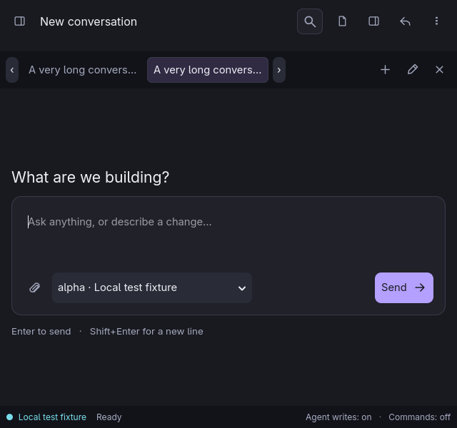

## Design choices and research

The workspace redesign addresses the supplied screenshots directly. A stable,
compact navigation rail replaces full-width navigation buttons. Workspace content
is centered within 1360 logical units; the conversation sidebar adapts to 230–340
units on resize while keeping draggable dividers. Native widgets and existing
callbacks remain the implementation boundary.

[Fluent toolbar guidance](https://fluent2.microsoft.design/components/web/react/core/toolbar/usage)
informed the single-line editor toolbar, labeled overflow actions and on-demand
search. [VS Code view guidance](https://code.visualstudio.com/api/ux-guidelines/views)
informed short destination names, restrained actions and purposeful empty states.
[GNOME sidebar guidance](https://developer.gnome.org/hig/patterns/nav/sidebars.html)
informed persistent navigation and a compact icon rail at narrow widths. These
are pattern adaptations to native CUI, not imported web components.

The conversation design puts the conversation and composer ahead of navigation.
A darker sidebar, restrained separators and consistent toolbar actions apply
[Linear's March 2026 interface refresh principles](https://linear.app/now/behind-the-latest-design-refresh).
The practical changes are separate Chats/Files views, a quieter model label,
icon actions with tooltips, and a compact toolbar at smaller widths.

Adjustable dividers, optional source context and keyboard access draw on
[VS Code's custom layout guidance](https://code.visualstudio.com/docs/configure/custom-layout).
The composer stays central on an empty workspace; three starting prompts provide
concrete next actions, following
[NN/g's empty-state guidance](https://www.nngroup.com/articles/empty-state-interface-design/).
Short windows and enlarged text hide those optional prompts to retain the input.

Stable navigation at the left, content in the center, and optional tools at the
right also apply the
[GNOME navigation guidance](https://developer.gnome.org/hig/guidelines/navigation.html)
and its [utility pane pattern](https://developer.gnome.org/hig/patterns/containers/utility-panes.html).
Consistent placement keeps source context available while a turn runs.

The first screen offers three concrete starting prompts; the source pane can be
hidden to focus on conversation. This applies
[progressive disclosure](https://www.nngroup.com/articles/progressive-disclosure/).
Live activity, explicit offline status, permission labels and cancellation apply
[visibility of system status](https://www.nngroup.com/articles/visibility-system-status/).
These are design choices informed by guidance, not evidence from a user study.

Charcoal surfaces use violet for identity and the primary action, cyan for
connection/author accents, and neutral text for source and conversation. Native
focus rings, keyboard navigation and text scaling remain enabled. Meaningful
states include text labels rather than relying solely on color. The desktop
supports midnight, light and plain palettes through the shared Settings editor.
Theme changes apply immediately; runtime settings require a restart.

## Isolation and implementation

`desktop/go.mod` is a nested module. It depends on `bifrost` and the local CUI
bindings. The parent `go.mod`, `cmd/bifrost`, and TUI package have no CUI imports.
`make build`, `make test`, and `make release` keep their existing scope.

`internal/cli/desktop_workspace.go` exposes the existing chat/runtime services.
It preserves account binding, session persistence, project/repository selection,
permissions, cancellation and rooted backend reads/writes. Marketplace, settings,
project and task callbacks are extracted from the existing TUI wiring, and both
frontends use those same implementations. `internal/ui/native_terminal.go` adapts
the existing PTY/session emulator; it does not introduce a second shell backend. New-conversation creation
explicitly uses the session store's Create operation: the startup resume helper
intentionally resumes existing history when its ID is empty.

Native calls run on the locked main OS thread. Workers send results through a
bounded queue drained by a CUI timer. Source/directory request IDs discard stale
results. Shutdown cancels work and drains workers before releasing the backend.
The renderer refreshes against native allocation changes so text reflows on
resize instead of scaling an old screenshot.

## Implemented TUI workflow coverage

| Workflow | Desktop path and shared implementation |
| --- | --- |
| Commands | All 25 canonical TUI commands and their aliases, completion and help; a test fails if a registry entry has no native handler. |
| Chat and sessions | Streaming, cancellation, new/resume, tabs, history, account/model changes and compaction through the same runtime and session store. |
| Files and editor | Rooted reads/writes, revision conflicts, shared editing/search/undo engine and shared durable draft format. |
| Viewer and review | Agent file/highlight/diff/snippet/walkthrough events, Next/Previous and the existing review backend. |
| Terminal | Same PTY/emulator, multiple live shells, colors, cursor, control input and bounded agent-command output tabs. |
| Settings and layouts | Searchable fields, staged validation, revision-safe save, conflict retention, themes, saved presets/proportions and drag resizing. |
| Accounts | Create/remove/connect profiles, discover models for new or saved profiles, browser login entry points and cancellation. |
| Skills and MCP | Catalog search, source preview, project/global installation through existing callbacks. Installation does not activate instructions. |
| Tasks | Parent/child monitoring, budgets, usage, worktree, result/events, refresh and cancellation through the existing scheduler. |
| Projects | Multi-repository scan/link/unlink, metadata/defaults, repository windows, README/GitHub PRs/issues and connector/Notion detail views. |

Functional coverage targets the **implemented TUI**, not every item in its
roadmap. Public catalog federation, integrated approval/MCP OAuth forms,
editor LSP overlays, hunk staging and terminal pixel images remain shared product
gaps. The TUI does not currently supply terminal mouse forwarding or a scrollback
browser either. The native task view uses a list and details rather than terminal
ASCII graph geometry. GUI keyboard shortcuts follow native input conventions;
Vim movement applies only inside the editor's normal mode.

Linux GTK/X11 is the exercised native platform. Windows/macOS runtime behavior,
Wayland resize behavior, screen-reader/IME coverage, real OAuth/vendor sessions,
real SSH GUI workflows and real graphical guests are not established by these
fixtures. Provider, GitHub and connector correctness continues to rely largely on
the shared backend fixture coverage. Remote operations retain the existing guest
boundary and capability limitations.

## Verification

```sh
go test -race -timeout=90s ./...
make desktop-test
make desktop-smoke
go vet ./...
CGO_ENABLED=0 go build -o bin/bifrost ./cmd/bifrost
```

The opt-in native test creates temporary workspace/config/state, two disposable
Git repositories and a loopback streaming fixture. It checks Send/Stop, streaming,
new/resumed conversations, stale reads, palette selection/focus, filtering, file
mentions and activity. The parity scenarios exercise editable native controls,
file save/conflict retention, draft switching, real X11 Left/Delete/Return and Ctrl+C input
into the PTY, Enter/Shift+Enter composer behavior, shell survival while hidden, settings save/conflict/theme changes,
profile switching, preview-gated catalog installation, task cancellation and
multi-repository linking/defaults. Further cases exercise real Vim keystrokes,
per-document undo/search and durable recovery, background chat isolation, viewer
walkthrough/focus, multiple PTYs, mention completion/context expansion, project
connector views, saved layouts, composer growth and command-output tab eviction.
Catalog and task UI interactions use injected
callbacks. Redesign regressions additionally cover both catalog categories,
MCP installation ID/scope, category switching during installation, task status
and text filters, retained repository drafts, common/advanced settings changes,
and real Ctrl+F/Escape editor input. Wide-layout assertions bound navigation and
reading widths; narrow project/catalog captures check the adaptive layout.
Chat-specific cases exercise native disclosure hit targets, stable grouped IDs,
turn-local tool updates, outgoing prompt flags and preservation of full details.
The conversation render uses a centered overlay whose sizing does not impose
fixed gutter minimums on the window. An 800×720 resize is asserted; captures
also exercise 150% text. Review regressions cover interleaved status/reasoning
with streamed replies, stale mention/caret rejection, account consistency across
tabs, command-ID reuse across runs, and save-all settings across field types.
Native failure tests reject an oversized recovery write, verify a later retry,
and force a draft-removal error before checking that reload retains state and
does not steal the selected file.
The normal application uses the shared TUI callbacks. No paid
inference, real account login or real user workspace mutation is performed.

Captures include 2560×1440, 1440×920, 800×720, 640×600, a 640×480 command palette, and
1200×900 at 150% text. `BIFROST_CAPTURE_DIR` names an existing capture directory.
The fixture uses Bash without user startup files and with temporary history.
It requires Bash, Python 3, X11/XTest libraries and `xprop` for native key
injection; ImageMagick `import` is needed only for optional screenshots.
Root service tests additionally check shared session export, account-switch
history retention, fresh session identity, default permissions and root traversal.

Actual native captures (local model fixture, not production inference):

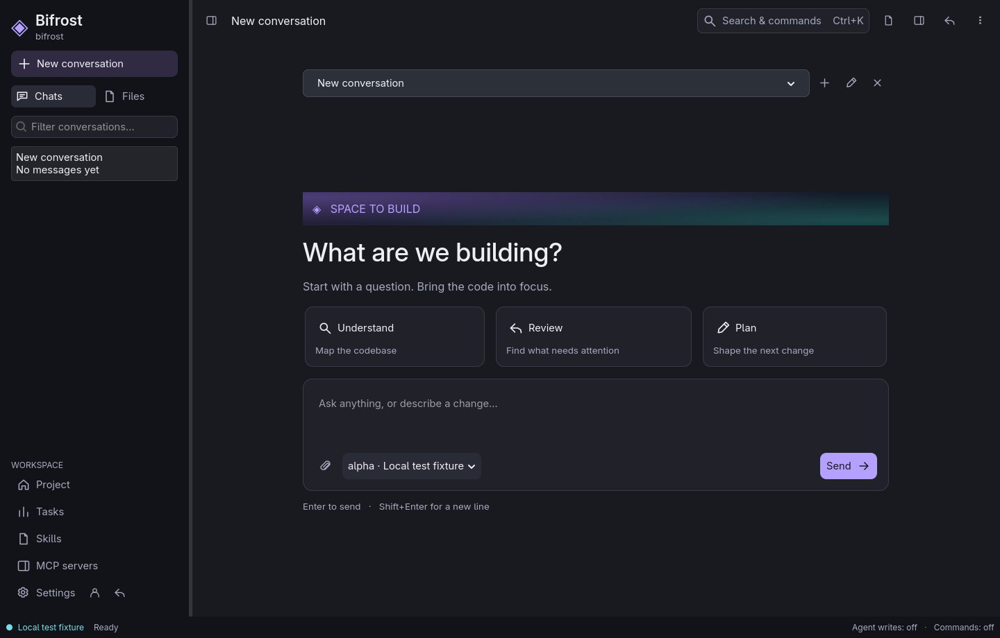
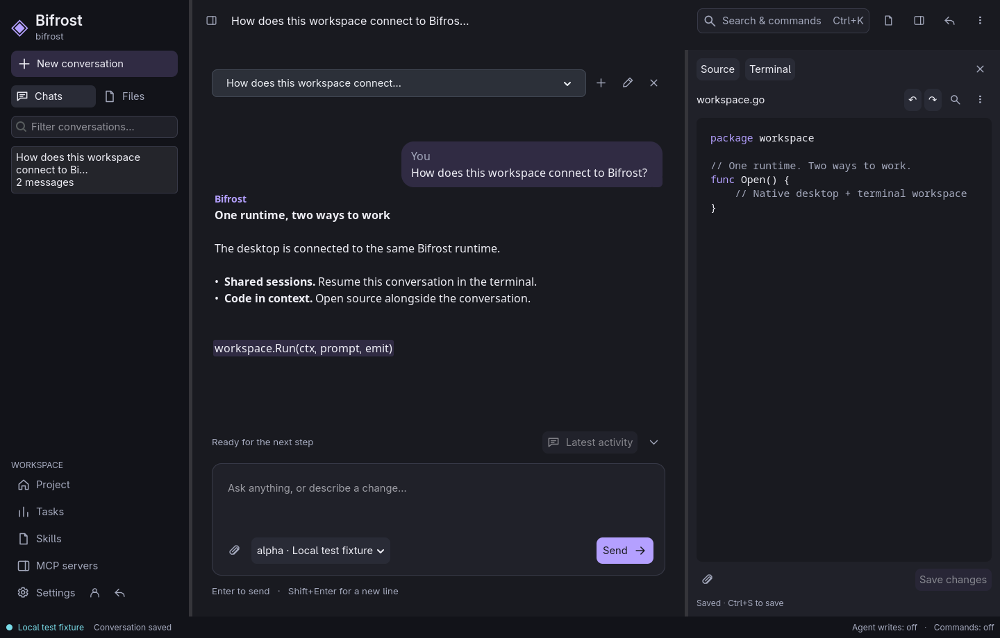
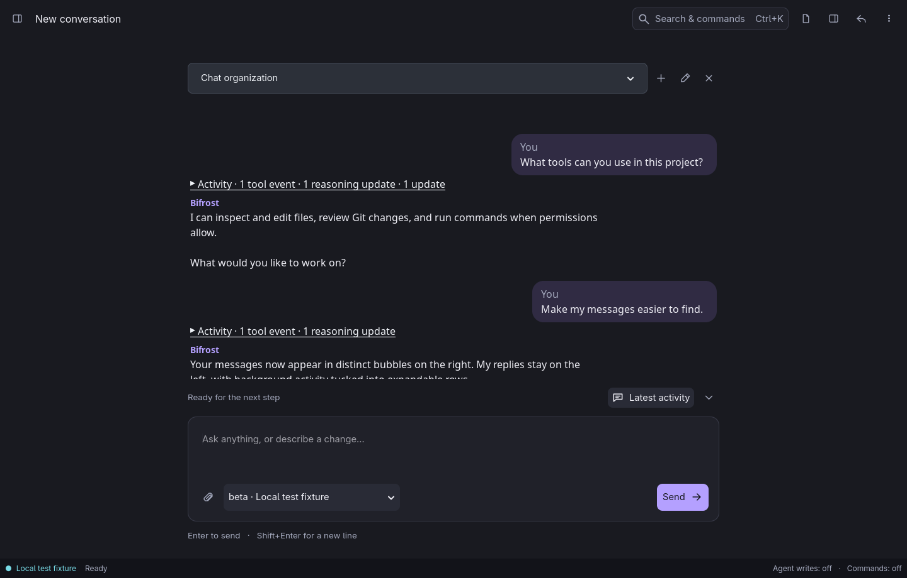


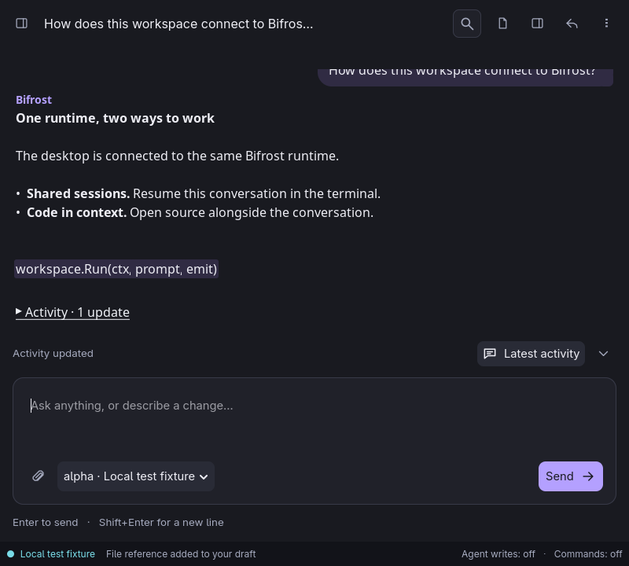
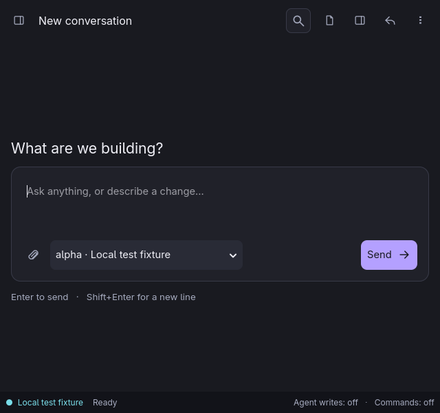
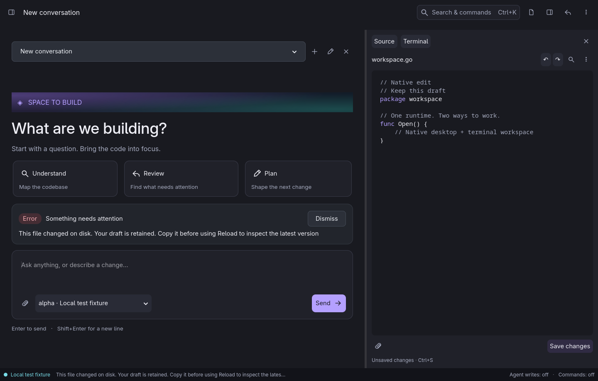


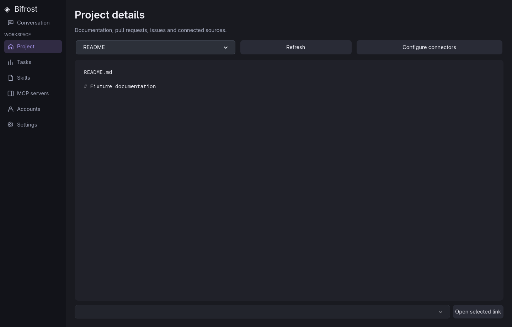
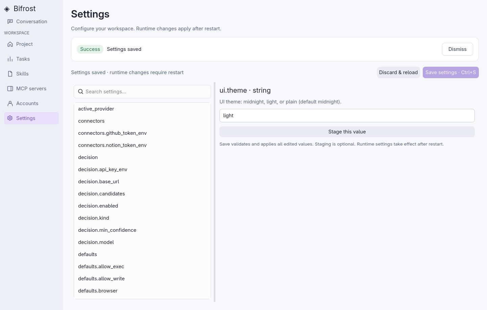


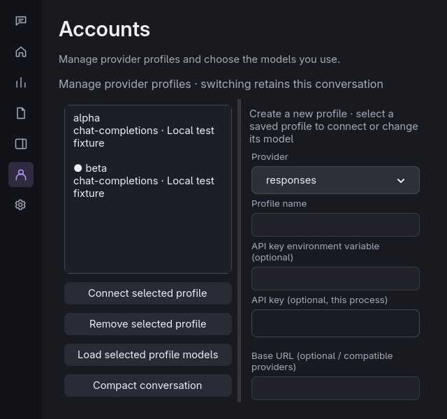

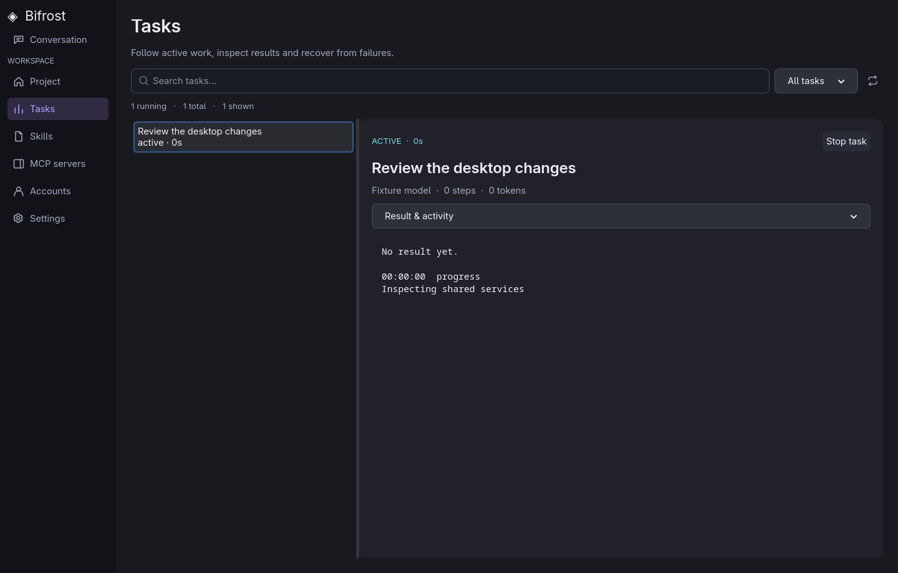
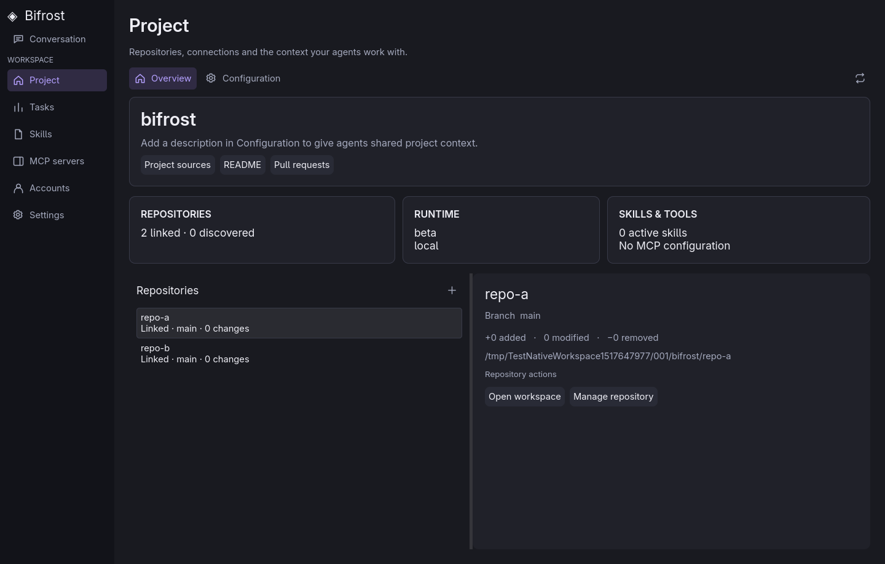


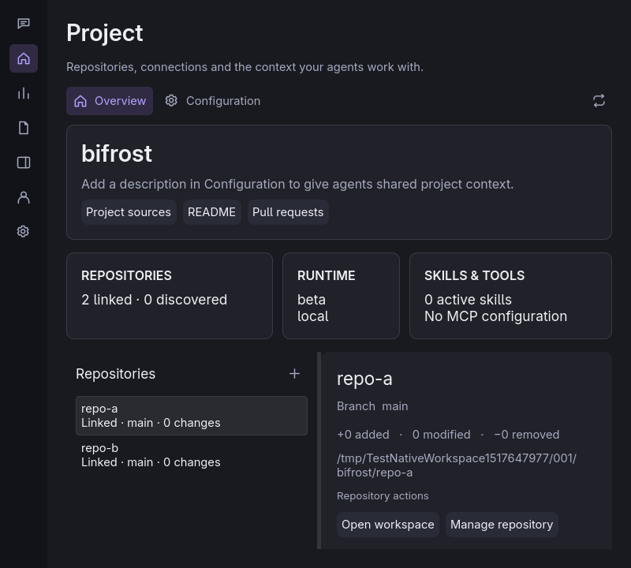


The structural quality check remains non-clean against the historical baseline;
it must not be represented as a clean merge gate. See current-build evidence for
the exact validation recorded for this increment.


### Explanation mode and task-aware skills — 17 October 2026

`:explain TOPIC` prepares a request in the composer without sending it or replacing
an unsent draft. Understand on the welcome screen prepares the same workflow.
The shared `viewer_flow` contract accepts code, concept and diff steps. A separate
scrollable explanation appears above the source/diff, with progress, Previous,
Next and End walkthrough. Back/Next clamps at the boundaries. Line highlighting
uses displayed content coordinates; supplied diff text never becomes an editable
file. Existing editor drafts survive viewer navigation and stale asynchronous
file reads are still ignored. `:walkthrough` exposes the actions through command
completion/help. Presentations are currently in-memory, not saved review state.

The native fixture covers concept → code → diff, return navigation, boundary
behavior, close, draft preservation and preparing a request without sending.
The README's explanation screenshots use disposable fixture code and an illustrative
diff. The shared skill tools implement metadata-first discovery, model-selected
activation and revision-checked resources; see [task-aware skills](../README.md#skills-selected-for-the-task).
They require Bifrost's native tool loop. Vendor clients do not expose these tools.

The skill loading design follows the primary [Agent Skills integration guidance](https://github.com/agentskills/agentskills/blob/main/docs/client-implementation/adding-skills-support.mdx).
Bundled guidance is original Bifrost content; no Ripwire implementation or upstream
skill files are copied, and no extra runtime dependency is installed.

## Cursor-native event and walkthrough fixes — 18 October 2026

Cursor-native now advertises the attached Bifrost skill discovery and viewer tools
through its MCP protocol bridge, including `viewer_flow`. Protocol arguments are
decoded from protobuf JSON values, including nested steps, lists, booleans and
nulls. Existing rooted validation and callback permissions still apply. This does
not enable arbitrary MCP servers or vendor-CLI tools; configured browser/SSH/MCP
runtime restrictions remain as documented.

Provider-supplied reasoning fragments update one activity entry per block. Tool
activity carries call identity, a useful name/path and bounded details. The final
aggregate is not replayed over text already streamed. Model steps and local tool
calls have separate bounds (up to eight tool calls per configured step, capped at
200); context/precheck negotiation does not consume the tool budget. Limits are
checked before executing the next tool.

Cursor search now uses Go's bounded RE2 engine instead of the shared literal
search API. It supports case flags, scoped paths, pagination, common file types,
and `**` path globs without shell permission. Traversal skips symlinks and common
metadata/cache trees, with file/byte/result bounds. This is not complete ripgrep
compatibility: PCRE lookaround/backreferences, full type aliases, ignore-file
semantics, context-line and sort options remain outside this increment.

Design references: [GNOME patterns](https://developer.gnome.org/hig/patterns.html)
for selection/search and native file dialogs; [Go regexp](https://pkg.go.dev/regexp)
for regular-expression behavior. GTK captures and protocol fixtures are evidence
for this build; live Cursor service acceptance still requires separate testing.

### Context, history, skills and sub-agent controls — 19 October 2026

See the [conversation controls](../README.md#conversation-controls-and-context),
[installed skill and sub-agent settings](../README.md#installed-skills-and-sub-agent-defaults),
and [command permissions](../README.md#command-permissions) for current behavior.
The context meter is a byte-based estimate, not a provider tokenizer measurement.
Original histories survive compaction; retained tool exchanges become inert portable
transcript text, without old opaque continuation checkpoints. A compacted fork is
used only if its estimated context is smaller. Both source and fork use turn locks.

Scope filters expose copies hidden by project/global precedence. Auto-load changes
are revision-checked and read on the next turn. Task-selected skills remain on-demand.
The sub-agent settings page supports catalog discovery, manual model IDs and profile
inheritance without changing the main model. Explicit spawn parameters take precedence.

Shell policy is enforced before native exec and at the Cursor Native filesystem
bridge. Detached approval requests are bounded by the originating turn's lifetime.
Vendor CLI backends cannot bypass this policy through delegation: unsupported command
approval is rejected at the external-run boundary. Headless runs do not fabricate approval.
