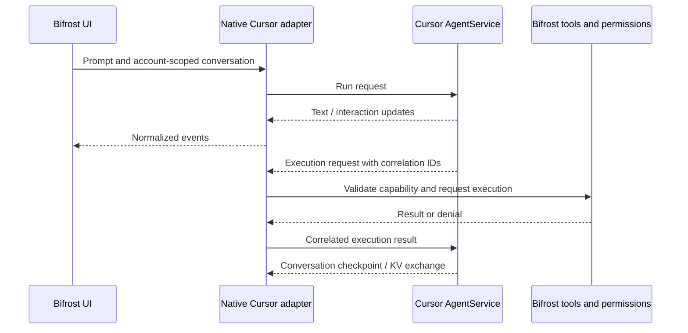

# Cursor client interoperability investigation

Investigated 2026-10-16. Target: installed Cursor **3.23.23**, commit
`2dac2428994fe34f12658d9ecad1541b98db2c00`. This is a static analysis report and
implementation brief, not a working native Cursor backend or a verified public API contract.

## Result

A native Go client appears technically feasible. The installed application exposes
enough authentication control flow and generated protocol descriptions to begin a
bounded compatibility implementation. Its full agent interface is a stateful,
bidirectional Connect/Protobuf protocol: a replacement client must handle local
execution, conversation state and interactive requests as well as generated text.

Bifrost currently uses the external Cursor agent CLI over ACP in
[`internal/agentbackend/cursor.go`](../../internal/agentbackend/cursor.go).
That code starts the configured executable with `acp`; it does not talk directly
to the service described here. Keep this adapter available while qualifying a
native implementation. `/usr/bin/cursor` is the desktop launcher, not a substitute
for the configured agent CLI.

## Installation and analysis scope

[Rea](https://github.com/morluto/rea) 6.5.0 is installed at
`/home/mathias/.local/bin/rea`, using `rea-agents@6.5.0` under
`/home/mathias/.local`. Installation used `--ignore-scripts --no-audit --no-fund`.
`rea --version` returns `6.5.0`. Its Node dependencies belong to this external
research tool; no application runtime or Go module dependency was added to Bifrost.
No MCP server registration or global agent configuration was changed.

`/usr/bin/cursor` resolves to `/usr/share/cursor/cursor`, a shell script launching
Electron 42 and `/usr/share/cursor/resources/app`. The relevant protocol and
authentication logic is in bundled JavaScript, so native disassembly of the
launcher would not answer this question.

Examined installed source artifacts:

| Artifact, relative to `/usr/share/cursor/resources/app` | Use |
| --- | --- |
| `package.json`, `product.json` | Version and build identity |
| `out/vs/workbench/workbench.desktop.main.js` | Desktop login, refresh, generated protocol types |
| `extensions/cursor-deeplink/dist/main.js` | Deep-link extension structure |
| `extensions/cursor-agent-host/dist/main.js` | AgentService module reconstruction with Rea |
| `extensions/cursor-agent-host/dist/agent-host-daemon/dist/bin/daemon.cjs` | Readable auth, transport and message definitions |

[The evidence index](cursor-client-evidence.json) records SHA-256 hashes, exact
zero-based UTF-8 byte offsets and search anchors. References such as `auth.poll`
below are index IDs. These remain useful even though the desktop bundle has very
long minified lines. Hashes must match before offsets are reused.

Rea parsed the selected deeplink and agent-host bundles without syntax failures,
recovering 202 and 1,108 modules respectively. Both runs hit a semantic-analysis
stack limit; their graph coverage is **partial**. The outgoing AgentService trace
matched one seed and contained 158 observed nodes and 535 inferred relationships,
with no terminal paths. This establishes static module relationships, not a
complete authentication-to-network execution trace.

Raw Rea results and local artifact copies are under ignored
`.research/cursor-3.23.23/`. The two application evidence IDs and trace ID are in
the evidence index. Initial sandbox worker failures were resolved with an
approved external static-analysis run. A broad first inventory also exceeded
available temporary storage; the successful runs used a narrowed artifact set
and a workspace-local temporary directory.

No installed Cursor code was executed during this inspection. User account
databases, tokens and keychains were not read, and no authenticated Cursor API
requests were made. Server acceptance, subscription entitlements and live model
availability therefore remain unverified.

## Authentication

### Browser login

Observed in `auth.generate`, `auth.login_url`, `auth.poll`, `auth.poll_cli`:

1. Generate a random 32-byte verifier and encode it as base64url. Hash the verifier
   with SHA-256 and base64url-encode that hash as the challenge. Generate a UUID.
2. Open the website's `/loginDeepControl` with `challenge`, `uuid` and `mode`.
   The daemon adds `redirectTarget=cli`; selected-team login is an explicit option.
   The desktop also supports selected-team login.
3. Poll the backend's `/auth/poll?uuid=…&verifier=…`. A 404 means the session is
   not ready. The desktop rejects results from a replaced pending login flow.
4. Accept the returned `accessToken` and `refreshToken`; desktop handling also
   processes optional `authId` and `selectedTeamId`.

The desktop defaults include website `https://cursor.com` and backend
`https://api2.cursor.sh`. They are configurable credentials/service settings,
not evidence that every RPC uses that host.

This is a custom challenge/verifier login with polling. It resembles PKCE but
should not be implemented as a generic OAuth authorization-code flow without
additional evidence. MCP OAuth implementations elsewhere in the bundle are a
different subsystem.

The desktop also accepts a `cursorAuth` deep link. Its login handler can receive
token fields or, for a tokenless callback, finish the pending polling flow
(`auth.callback`). For a new client, start and own the login flow rather than
importing desktop credentials or relying on token-bearing callback URLs.

### Refresh and API-key exchange

| Path | Observed behavior | Evidence |
| --- | --- | --- |
| Desktop refresh | POST backend `/oauth/token`, JSON `grant_type=refresh_token`, `client_id`, `refresh_token`; handles a server logout response | `auth.refresh` |
| Agent API-key exchange | POST backend `/auth/exchange_user_api_key`, bearer API key, JSON `{}`; expects access and refresh token fields | `auth.exchange_key` |
| Agent refresh policy | Reuses a current/ephemeral token if not expiring; otherwise invokes refresh | `auth.reuse` |
| Agent API-key refresh | Reads the API key from its credential manager or `CURSOR_API_KEY` and exchanges it | `auth.refresh_key` |

The agent expiry helper uses JWT expiry with a five-minute margin. This is an
expiry hint, not signature verification (`auth.expiry`). The desktop refresh
implementation passes the returned `access_token` into both token storage slots
(`auth.refresh_storage`). That is an observation about this build; do not assume
it is the universal refresh-token contract or reproduce it without a live test.

Account-scoped credential storage, cancellation, refresh serialization and stale
result rejection are required in Bifrost. Credential validity and membership are
separate: a token does not establish permission to use every advertised model.

## Service API and streaming

The generated descriptors identify these surfaces:

| Service | Relevant methods | Interpretation |
| --- | --- | --- |
| `agent.v1.AgentService` | `Run`, `RunSSE`, `RunPoll` | Full agent session stream |
| `agent.v1.AgentService` | `GetUsableModels`, `GetDefaultModelForCli` | Candidate model discovery for a client |
| `agent.v1.AgentService` | `NameAgent`, `UpdateConversationMetadata`, `UploadConversationBlobs`, `GetPromptContextUsage` | Conversation and context operations |
| `aiserver.v1.BidiService` | `BidiAppend` | Client inputs for the HTTP/1 stream alternatives |
| `aiserver.v1.InferenceService` | `Stream`, `RunInference`, SSE/Poll variants | Additional inference surface; suitability for independent generation is unverified |

Evidence: `api.agent_service`, `schema.agent_service`, `schema.bidi_service`,
`api.inference_service`. Method presence in shipped code does not establish a
public or enabled endpoint. In particular, the inference service is a research
lead, not an established OpenAI-compatible API.

Transport selection is explicit in `transport.factory`:

- With HTTP/2 enabled, use the normal bidirectional transport.
- For HTTP/1, use the mapped server-streaming SSE method unless SSE is disabled;
  otherwise use the mapped Poll method.
- Both HTTP/1 alternatives send client messages separately using `BidiAppend`.

Append messages carry request identity and an increasing append sequence number;
payloads can be binary or hex-encoded. Poll replies contain sequence numbers,
hex-encoded message data and an optional EOF flag. The client validates response
ordering. Evidence: `transport.append`, `transport.sse`, `transport.poll`,
`schema.bidi_append`, `schema.bidi_poll`.

Do not equate the method name `RunSSE` with a generic JSON/EventSource chat API:
the surrounding transport is Connect with typed messages. A Go implementation
must reproduce the observed envelope/encoding contract and cancellation behavior.
Runtime configuration determines which transport is used; the descriptors alone
do not establish the active mode for every installed client.

Bearer credentials and client/request/team/privacy metadata appear in request
construction. The application also has endpoint routing and region configuration.
The minimum accepted header set and the correct route for a native client have
not been established. Do not infer that all observed metadata or integrity
headers are mandatory, or copy unrelated machine identity values into Bifrost.

## Conversation and tools

`AgentRunRequest` includes conversation state, action, model details, MCP tools,
conversation ID, skill options and optional system prompt. Later fields describe
capabilities, run/session identity and sub-agent model choices (`agent.run_request`).
This is richer than a list of chat messages; recovering field names alone does
not establish a minimal valid initial request.

Client envelopes include run requests, execution results/control, KV messages,
conversation actions, interaction responses and heartbeats. Server envelopes
include interaction updates, execution requests/control, conversation checkpoints,
KV messages and interaction queries. See `schema.agent_client` and
`schema.agent_server`.

Execution messages correlate requests and results using `id` and `exec_id`.
Their variants cover shell, file operations, search, diagnostics, MCP, streamed
and background commands, fetch, computer use, hooks and sub-agents. Corresponding
result and abort/heartbeat forms are defined. See `schema.exec_client` and
`schema.exec_server`. Schemas describe capabilities; they do not prove the
sandboxing behavior of a particular executor.



This diagram is the proposed Bifrost mapping of the observed message types, not
a captured live session. Unknown execution variants must receive a supported
denial/error response; they must never become an unchecked command execution path.

## Implementation sequence for Bifrost

1. **Pin the wire contract.** Extract a minimal schema dependency closure for
   model discovery and a text-only run. Preserve field numbers, scalar types,
   oneofs and optional/repeated semantics. The daemon uses compact descriptors;
   decode them against its protobuf runtime rather than guessing numeric types.
   Build synthetic encode/decode fixtures without distributing application bundles.
2. **Own authentication.** Add a separate native Cursor account mode using a
   user-initiated browser flow and private account storage. Implement pending,
   cancelled, expired, denied and success states. Keep API-key exchange distinct
   from browser login and qualify refresh behavior separately.
3. **Qualify one transport.** Start with one supported mode, bounded reads,
   cancellation and useful error classification. Prove model discovery before
   generation, then a single text turn. Add HTTP/1 alternatives after the first
   mode works. Candidate Go dependencies are protobuf and Connect; assess their
   exact necessity when schemas and framing are settled. No Node runtime is needed
   in the native client.
4. **Persist conversation state.** Implement checkpoint/blob/KV handling,
   interrupted-run recovery and account-scoped continuation data. Retain Bifrost's
   readable portable history when switching accounts, but never reuse another
   account's opaque remote session state.
5. **Bridge local execution.** Map a small allowlisted set of read/search tools,
   then revision-safe edits and bounded commands through existing permissions.
   Add MCP/browser/desktop/sub-agent variants only when their contracts are tested.
   Preserve request identity and do not retry a mutation with an uncertain outcome.
6. **Expose and monitor.** Normalize output, usage, permissions and tool events into
   the existing UI/task interfaces. Keep the native backend explicitly experimental
   until live login, refresh, cancellation, resume and account-switch tests pass.

Required validation gates: malformed/oversized frames; missing or reordered
sequence numbers; expired credentials; refresh races; unsupported tools; duplicate
execution IDs; cancellation during execution; permission rejection; checkpoint
restart; and cross-account state isolation. A live test with an authorized account
must establish server acceptance and actual subscription/model behavior. No such
test was performed during this investigation.

## Reproducing the static analysis

The narrowed artifact directory is local and ignored. From the repository root:

```sh
TMPDIR="$PWD/.research/cursor-3.23.23/tmp" rea analyze-javascript-application \
  "$PWD/.research/cursor-3.23.23/artifacts" \
  --source-path extensions/cursor-agent-host/dist/main.js \
  --max-semantic-nodes 4000 --max-semantic-nodes-per-file 4000 \
  --max-heap-mb 2048 --analysis-timeout-ms 90000 --format json
```

The deeplink run used its own relative source path, node limits of 3000 and a
60-second analysis timeout. Rea's
[CLI documentation](https://github.com/morluto/rea/blob/main/docs/cli.md)
describes application analysis and feature traces. Keep all coverage warnings
alongside any output. Rerunning against a new Cursor release requires fresh
artifact hashes and offsets; the evidence index is specific to this installation.
